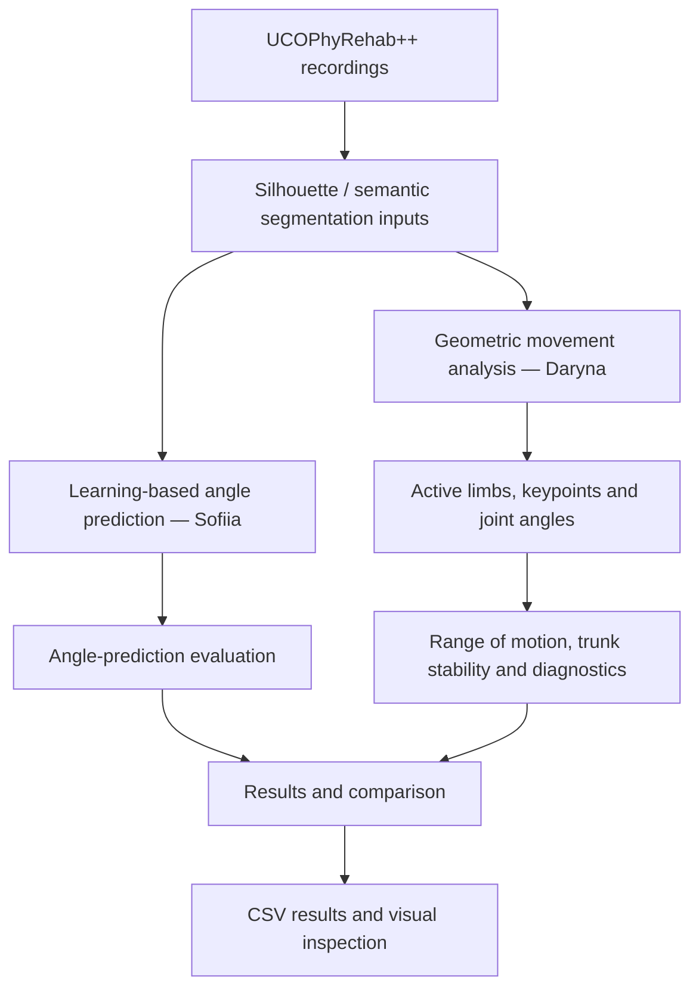
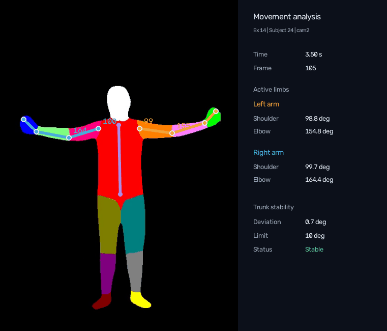
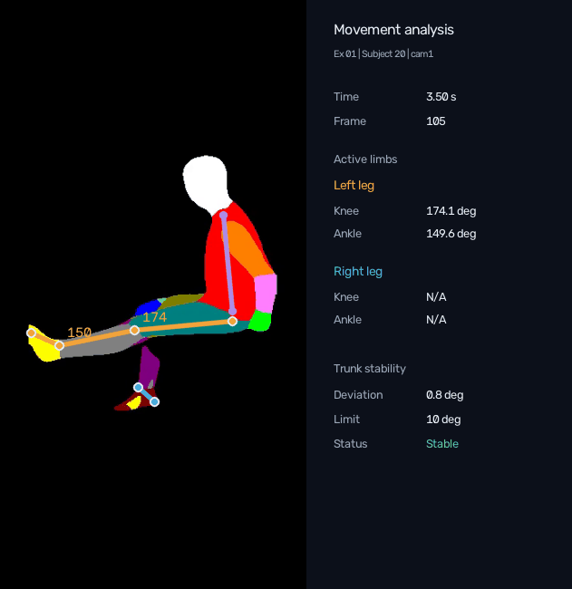
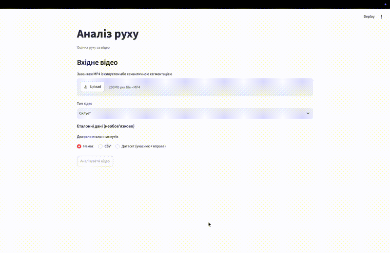
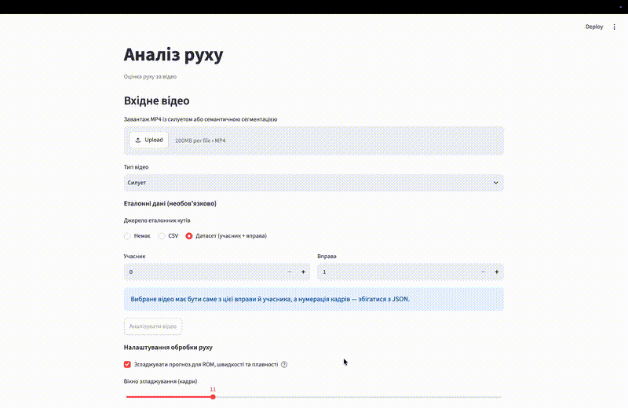

# Rehabilitation Exercise Analysis with UCOPhyRehab++

A computer vision project for analysing rehabilitation exercises from multiple camera views. We investigate two complementary approaches: learning-based joint-angle prediction from visual representations and geometry-based movement analysis using segmented body regions.

Built on the [UCOPhyRehab++](https://github.com/AVAuco/ucophyrehabpp) dataset and its reference experiment pipeline.

## Team

| Member | Main responsibility |
|---|---|
| Daryna Prytula | Geometric movement analysis, active-limb detection, joint-angle estimation, movement diagnostics, exploratory repetition analysis, visualisation |
| Sofiia Pereima | Model training, evaluation, and comparison of joint-angle prediction using silhouettes and semantic segmentation  |

## Problem and motivation

Rehabilitation has become an essential part of life for many Ukrainians. Performing prescribed exercises correctly is an important part of recovery: it can help reduce the risk of injury, avoid unnecessary physical strain and improve the effectiveness of rehabilitation.

Exercise quality is usually assessed by a physiotherapist. However, continuous professional supervision is not always possible, especially when patients complete part of their rehabilitation independently. Modern computer vision and movement-analysis methods offer a way to process video recordings automatically and examine human movement and exercise technique.

In this project, we investigate how accurately rehabilitation exercises can be analysed using different visual representations of movement. Our original proposal envisaged a system that takes an exercise recording as input and predicts an exercise-quality score. As a step towards that broader goal, the current work studies joint-angle prediction from silhouettes and semantic segmentation, alongside geometry-based analysis of active limbs, joint angles, range of motion and trunk stability. We have also experimented with repetition counting and smoothness, but these are not part of the current geometric output.

Our main motivation is to contribute to addressing a problem that matters to many people, with the potential to make rehabilitation easier for patients and support the work of physiotherapists. The project also gives us an opportunity to investigate the capabilities and limitations of modern artificial intelligence and computer vision methods for analysing human movement.

## Dataset

We work with UCOPhyRehab++, a multi-view and multi-modal dataset for rehabilitation exercise analysis. The dataset used in our project contains:

- 27 participants (IDs `0`–`26`);
- 16 exercises (`01`–`16`);
- 5 camera viewpoints (`cam0`–`cam4`);
- recordings at 30 FPS;
- visual representations including silhouettes, semantic segmentation, and optical-flow modalities in the original dataset.

The full nominal participant–exercise–camera combination count is 27 × 16 × 5 = 2,160.

Our geometric pipeline primarily uses semantic segmentation videos. The model experiments explore silhouettes and semantic segmentation as inputs.

**Data source:** [UCOPhyRehab++ on Zenodo](https://doi.org/10.5281/zenodo.17935736). The dataset is not included in this repository; follow the dataset's own access and licence terms.

### Visual representations

The dataset includes several visual representations of rehabilitation exercises, including silhouettes, semantic segmentation, TV-L1 and GMFlow optical flow.


*Examples of the different visual representations available in UCOPhyRehab++.*

## Approach



### 1. Learning-based angle prediction

The learning-based pipeline builds on the original UCOPhyRehab++ implementation and uses a ResNet18-based architecture with Hydra configurations. We trained and evaluated two models for joint-angle prediction using silhouettes (SILS) and semantic segmentation, covering all 16 rehabilitation exercises and five camera viewpoints.

To prevent data leakage, we split the dataset at the participant level: 21 participants were allocated to development and 6 to independent testing. We performed 5-fold cross-validation separately for both visual modalities, resulting in 10 training runs. Each fold was trained for up to 10 epochs, and the validation results were used to select the final training configuration.

Following cross-validation, we trained two final models on all 21 development participants for 3 epochs. The trained checkpoints and normalization parameters are stored in `models/sils/` and `models/semantic_segmentation/`, with model weights tracked using Git LFS.

The final models were evaluated on the six held-out participants using Mean Absolute Error (MAE) and Root Mean Squared Error (RMSE). We also analysed prediction accuracy across exercises, participants and camera viewpoints, as well as movement characteristics derived from predicted joint-angle trajectories.

### 2. Geometric movement analysis

Unlike the learned predictor, this pipeline processes the colours/regions in semantic segmentation frames and applies geometric and temporal rules.

The main processing stages are:

1. Read segmentation frames and identify relevant body regions (for example, thigh, shin and foot for leg exercises).
2. Detect the moving limb or limbs using changes across frames, rather than assuming a fixed left/right side. Handle exercises in which one or two limbs move.
3. Estimate keypoints from the detected regions and their geometry.
4. Compute the main joint angles and measure changes across time. The relevant joints depend on the exercise.
5. Calculate range of motion (ROM) from smoothed joint-angle trajectories and assess changes in trunk orientation.
6. Export per-frame and per-video CSV results, including coverage measures and diagnostic information. Visualisations can be generated locally to review the results.

We tested mirrored movements, cases where both limbs are active, missing segment detections and sudden jumps in estimated angles. Movement detection uses a time window beginning 3.5 seconds into the video, reducing the influence of initial setup movements. The configuration file is the source of truth for the settings used in a new run.

Limitation: angles inferred from a 2D view are not automatically equivalent to 3D joint angles. Occlusion, camera perspective and imperfect segmentation can affect the measurements. Consequently, geometric output should not be compared to 3D references as if it were an identical measurement without describing the projection assumptions.

## Evaluation

We evaluate the two components separately, because they produce different outputs and have different ground-truth requirements.

| Component | Measure | Interpretation |
|---|---|---|
| Learned angle predictor | MAE (degrees) | Error against the target angle labels used by the reference pipeline |
| Learned angle predictor |	RMSE (degrees) |	Root mean squared error against reference joint angles
| Learned angle predictor | Cross-validation mean ± standard deviation | Performance variation across participant-based folds |
| Geometric pipeline | Limb-detection / joint-angle coverage | Fraction of frames in which the required outputs were obtained |
| Geometric pipeline | Missed detections and angle discontinuities | Diagnostic indicators of geometric robustness |
| Geometric pipeline | Range of motion (ROM) | 95th–5th percentile range of smoothed joint angles, reported in degrees |
| Geometric pipeline | Trunk-angle changes | Descriptive stability signal, dependent on viewpoint and chosen thresholds |

We use CSV summaries and visualisations of videos and individual frames to identify problems across different exercises, participants and camera angles. However, finding a keypoint does not always mean its position is correct. To evaluate the accuracy of our geometric algorithm, we plan to manually annotate a small set of frames with joint positions for comparison. Independently labelled repetition boundaries would also be needed before repetition counting could be reported as a validated feature.

## Results

#### Learning-based angle prediction

Both final models were evaluated on the same independent test set containing six previously unseen participants.

| Model | Test MAE |
|---|---:|
| SILS | 12.788° |
| Semantic Segmentation | 11.504° |

The reported values are frame-weighted mean absolute errors across the evaluated camera viewpoints. Semantic Segmentation achieved a lower average error than SILS, indicating that body-region information can improve joint-angle prediction compared with silhouette-only representations.

In addition to frame-level accuracy, we analysed predicted movement trajectories, including:

- Range of Motion (ROM): angular range covered during movement.
- Angular Velocity: changes in joint angle over time.
- Repetition Detection: identification of complete and incomplete exercise repetitions.
- Ground Truth Comparison: comparison of predicted and reference joint-angle trajectories.

We generated CSV summaries and visualisations to examine model behaviour across participants, exercises, and camera viewpoints.

##### Evaluation on self-recorded videos

We also recorded our own rehabilitation exercise videos and converted them into silhouettes, with each exercise filmed simultaneously from two camera viewpoints. We evaluated the pretrained SILS model without retraining to examine its performance on recordings collected outside the original dataset. The key finding was that angle predictions varied across camera viewpoints, indicating limited cross-view consistency on unseen exercises. These exploratory results highlight a limitation in the model's ability to generalise.

#### Geometric movement analysis

We evaluated the geometric algorithm on all 27 participants, covering 16 rehabilitation exercises and five camera viewpoints, for a total of 2,160 videos.

The evaluation focused on active-limb detection, joint-angle estimation, range of motion (ROM), trunk stability and movement diagnostics. We analysed the results across exercises, participants and camera views to identify cases where the algorithm still has difficulties detecting body parts and tracking movement.

| Measure | Result |
|---|---:|
| Mean coverage of selected-limb geometry | 77.85% |
| Mean trunk-orientation coverage | 99.20% |
| Mean proportion of stable trunk frames among frames with a known status, averaged across videos | 84.82% |

These results are descriptive metrics calculated from `video_summary.csv`, with each video contributing equally. Coverage indicates how often the algorithm produces measurements, but does not confirm the accuracy of the estimated keypoints or joint angles. Trunk stability is assessed using a predefined threshold and depends on the camera viewpoint, so it should not be interpreted as a clinical assessment.

The algorithm also calculates joint-level ROM and detects sudden changes in estimated angles. We experimented with repetition counting and movement smoothness analysis, but these features still need improvement and validation before being included in the final implementation.

Detailed evaluation results are available in `all_summary.csv`. To assess the accuracy of the geometric algorithm, we also plan to compare its estimated joint positions with manually labelled keypoints.


## Geometric Movement Analysis — Visual Examples

Examples of active limb detection, joint angle estimation, and trunk stability analysis.

<p align="center">
  
  
</p>

#### Interactive application

We developed a Streamlit application to demonstrate the trained models and analyse rehabilitation exercises.

The application allows users to upload preprocessed SILS or Semantic Segmentation videos, select a trained model, predict joint angles, visualise movement trajectories, compare predictions with Ground Truth when available, calculate movement descriptors, and export results as CSV files.

The application currently supports uploaded preprocessed MP4 videos rather than raw camera footage or real-time camera input.

The videos below show how our Streamlit application works.

!




## Installation

### Clone the repository

For the original UCOPhyRehab++ baseline:

```bash
git clone https://github.com/spereima/rehabilitation-project.git
cd rehabilitation-project
```

### Create the environment

**Option A — Conda (reference setup)**

```bash
conda env create -f requirements.yaml
conda activate ucophyrehab2
```

**Option B — pip**

```bash
python -m venv .venv
# Windows PowerShell:
.venv\Scripts\Activate.ps1
# Linux/macOS:
# source .venv/bin/activate
pip install -r requirements.txt
```

### Download trained models

The final SILS and Semantic Segmentation model checkpoints are stored using Git Large File Storage (Git LFS).

Install Git LFS if it is not already available, then run:

```bash
git lfs install
git lfs pull
```

This downloads the trained model weights required for inference.

### Run the Streamlit application

The project includes a Streamlit application for joint-angle prediction and rehabilitation exercise analysis.

Install the application dependencies:

```bash
pip install -r rehab_site/requirements.txt
```

Launch the application from the project root:

```bash
python -m streamlit run rehab_site/app.py
```

The application supports uploading preprocessed SILS and Semantic Segmentation MP4 videos, selecting a trained model, visualising predicted joint angles, comparing predictions with Ground Truth when available, analysing movement characteristics, and exporting results.


## Data preparation and model experiments

We adapted the original UCOPhyRehab++ pipeline for participant-based cross-validation, final model training, and evaluation across multiple camera viewpoints.

### 1. Dataset preparation

We used preprocessed SILS and Semantic Segmentation frames from `dataset_check_frames_small.zip` and reference joint-angle annotations from `dataset_3d_with_angles.json`.

The data was organised into participant-disjoint development and test sets, with 21 participants used for cross-validation and final training and 6 reserved for independent evaluation.

### 2. Five-fold cross-validation

We conducted five-fold cross-validation for both visual representations using the adapted training script:

```bash
python -m src.cli.train_cv
```

Each fold was trained for up to 10 epochs. Validation metrics were collected and compared to select the final training configuration.

### 3. Final model training

We trained the SILS and Semantic Segmentation models on all 21 development participants for three epochs using:

```bash
python -m src.cli.train_final
```

The final checkpoints and normalization parameters are available in:

```text
models/
├── sils/
│   ├── epoch_3.pth
│   └── final_train_norm_params.json
└── semantic_segmentation/
    ├── epoch_3.pth
    └── final_train_norm_params.json
```

### 4. Final evaluation

Both models were evaluated on the held-out test participants using:

```bash
python -m src.cli.test_final
```

We calculated prediction errors and generated comparisons across exercises, subjects, and camera viewpoints.

### 5. Movement descriptor analysis

We analysed predicted joint-angle trajectories to examine movement characteristics beyond frame-level prediction accuracy.

```bash
python -m src.analysis.compare_movement_descriptors
```

The complete experimental workflow, including the Hydra configurations and execution parameters, is documented in `notebooks/cross_validation_sils_segm.ipynb`.


### Running the geometric pipeline

The geometric algorithm runs separately from the Hydra-based models. It uses colour-coded semantic segmentation videos, not raw RGB footage. Set `BASE`, `OUTPUT`, `SUBJECTS`, `EXERCISES` and `CAMERAS` in `src/geometric_algorithm/config.py` for your local data before running it. The input layout is `BASE/<participant>/<exercise>/cam0.mp4` (and likewise for other cameras). Install the dependencies in `src/geometric_algorithm/requirements.txt` where applicable.

It saves per-frame and per-video CSV measurements and diagnostics. Images and annotated videos are optional local outputs, not included in the repository at present. For runs that import `visualization`, make sure the local `visualization.py` module is available, even when image saving is disabled.

To run the algorithm from the project root, use:

```bash
python src/geometric_algorithm/run.py
```

## Repository structure

```text
.
├── conf/
│   ├── data/
│   ├── experiment/
│   ├── loss/
│   ├── model/
│   ├── training/
│   └── default.yaml
├── data/
│   ├── manifests/
│   └── splits/
├── scripts/
│   ├── build_manifest.sh
│   ├── prepare_dataset.sh
│   ├── train.sh
│   └── test.sh
│   └── analyze_all_cameras.py
│   └── build_cross_camera_manifests.py
│   └── extract_test_cameras.py
├── src/
│   ├── cli/
│   ├── data/
│   ├── logging/
│   ├── loss/
│   ├── metric/
│   ├── model/
│   ├── normalization/
│   ├── analysis/
│   ├── geometric_algorithm/
│   └── utils/
├── requirements.txt
├── notebooks/
│   └── cross_validation_sils_segm.ipynb
├── models/
│   ├── sils/
│   │   ├── epoch_3.pth
│   │   └── final_train_norm_params.json
│   └── semantic_segmentation/
│       ├── epoch_3.pth
│       └── final_train_norm_params.json
├── results/
├── rehab_site/
│   └── app.py
│   └── requirements.txt
└── README.md
```

### Geometric algorithm

The geometric algorithm consists of several modules:

- `run.py`: runs the algorithm for selected participants, exercises and cameras.
- `config.py`: stores paths and processing settings.
- `segmentation.py`: extracts body-part masks from frames.
- `keypoints.py`: detects joint positions.
- `tracking.py`: tracks joints across frames.
- `geometry.py`: calculates joint angles.
- `movement.py`: identifies moving limbs.
- `repetitions.py`: experimental repetition-counting logic, not part of the final geometric run.
- `pipeline.py`: manages video processing.
- `results.py`: saves processing results.
- `smoothness.py`: experimental movement-smoothness calculations.
- `visualize_results.py`: local visualisation helper.

The algorithm saves per-video `frames.csv`, `summary.csv` and `diagnostics.csv`, as well as aggregate `video_summary.csv` and `missing_reasons.csv`. It may also produce local plots, frame snapshots and annotated videos.

### Performance optimisation

We optimised the geometric algorithm by improving colour-based segmentation, processing only the region containing the person, reducing repeated calculations and improving parallel processing.

In our local performance tests, processing 480 videos took approximately 6 minutes with the optimised workflow, compared with more than 8 hours for an earlier implementation. This is a machine- and configuration-specific comparison, not a general benchmark. We checked that the optimised geometric calculations agreed with the earlier implementation on the videos used for equivalence testing; we have not established bit-for-bit identity across every possible input.

## Reproducibility

- **Participant separation:** Keep the held-out test participants separate from all model selection, tuning and cross-validation.
- **Configuration:** Preserve the Hydra settings for learned models and record geometry thresholds for each run.
- **Environment:** Record Python and library versions, hardware type and the git commit used for published results.
- **Data provenance:** Document the dataset version, modality, file manifest and any missing video paths.
- **Evaluation:** Report fold-level scores, not only one mean or one favourable run. Distinguish exploratory, validation and final test findings.
- **Outputs:** Save CSV metrics and illustrative plots/videos under documented paths.

## Limitations and next steps

- Models may overfit to visually similar frames; subject-wise validation and camera-specific comparisons are important.
- The models are trained and validated on a relatively small number of participants (21 for development and 6 for independent testing), which may limit generalisation to a broader population.
- The models predict only one angle per frame instead of separate angles for different joints, which can make both joint-angle prediction and detailed movement analysis inaccurate for some exercises.
- The models may give different angle predictions depending on the camera viewpoint (additional evaluation on self-recorded videos showed inconsistent predictions between cameras for some unseen exercises).
- Segmentation mistakes and occlusion affect geometric keypoints and angle estimates.
- The geometric pipeline needs manually annotated 2D joint locations and exercise-specific movement labels to establish accuracy beyond detection coverage.
- A 2D camera view may not capture out-of-plane movement or compensation correctly.
- Generalisation to newly recorded videos requires consistent camera setup and external testing.

For the final version, we plan to:
1. Add a demo showing how both algorithms work.
2. Check the accuracy of the geometric algorithm using manually labelled keypoints.
3. Improve the geometric algorithm's performance on exercises where it still has problems.
4. Test the models on other visual representations, including TV-L1 and GMFlow (optical flow), and compare the results with Silhouette and Semantic Segmentation.
5. Try to combine the geometric algorithm and the machine learning models into one system. This would allow us to combine joint-angle prediction with active-limb detection, movement tracking and trunk stability analysis. We also want to see whether combining both approaches can improve accuracy and reliability.
6. Develop a real-time rehabilitation exercise analysis platform that uses a camera to track movements and give users feedback on how they perform exercises, without having to upload videos first.
7. Improve repetition counting and movement smoothness analysis, test them using manually labelled repetitions, and include them in the final version once the results are reliable.
8. Validate the results with physiotherapists. Develop exercise-quality predictions based on movement characteristics and compare them with physiotherapists' assessments to check how well our system evaluates exercise performance.

## AI usage

We used AI assistants for advice on algorithm optimisation to improve processing speed, coding assistance when developing and improving our algorithms, and help with organising and structuring the README documentation.

## Contribution statement

| Member | Contribution area |
|---|---|
| Daryna Prytula | Geometric algorithm, moving-limb selection, keypoint and angle extraction, ROM and trunk diagnostics, experimental repetition analysis |
| Sofiia Pereima | Learned angle-prediction experiments, modality comparison, model validation |


## Weekly team progress (October 2026)

| Week | Daryna: Geometric algorithm | Sofia: Learning-based models |
|---|---|---|
| **Week 1 (Oct 1–7)** | Developed initial joint detection and angle calculation. Tested different camera views and identified issues with moving leg detection. | Prepared silhouette and semantic segmentation data. Configured models and started initial experiments. |
| **Week 2 (Oct 8–14)** | Improved moving limb detection, added mirrored exercise support and trunk stability analysis. Implemented CSV outputs and diagnostics. | Trained initial models using a participant-based train/validation/test split (21/3/3). Evaluated initial training and validation results. |
| **Week 3 (Oct 15–21)** | Extended the algorithm to arm exercises. Experimented with repetition counting and smoothness, and separated the geometric pipeline into modules. | Continued model training and analysed performance across SILS and Semantic Segmentation representations. Compared prediction errors and training results. |
| **Week 4 (Oct 22–25)** | Tested more exercises, participants and cameras. Optimised processing from over 8 hours to around 6 minutes for 480 videos. Checked output equivalence on selected videos and prepared visualisation tools. | Identified overfitting in the initial models and switched to participant-based 5-fold cross-validation. Completed cross-validation, trained and evaluated final models, analysed movement descriptors, and developed a Streamlit application for joint-angle prediction. |


## License and citation

This project uses the UCOPhyRehab++ dataset and builds on the original research by Aguilar-Ortega et al. (2026). The dataset and original code remain subject to their respective licensing terms.

If you use this project or its dataset, please cite the original publication:

```bibtex
@article{AguilarOrtega2026,
  author  = {Aguilar-Ortega, Rafael and Zafra-Palma, Jorge and Mu{\~n}oz-Salinas, Rafael and Marin-Jimenez, Manuel J.},
  title   = {UCOPhyRehab++: A multi-modal and multi-view dataset for human rehabilitation analysis},
  journal = {Scientific Data},
  year    = {2026},
  doi     = {10.1038/s41597-026-07362-5},
  url     = {https://doi.org/10.1038/s41597-026-07362-5}
}
```
